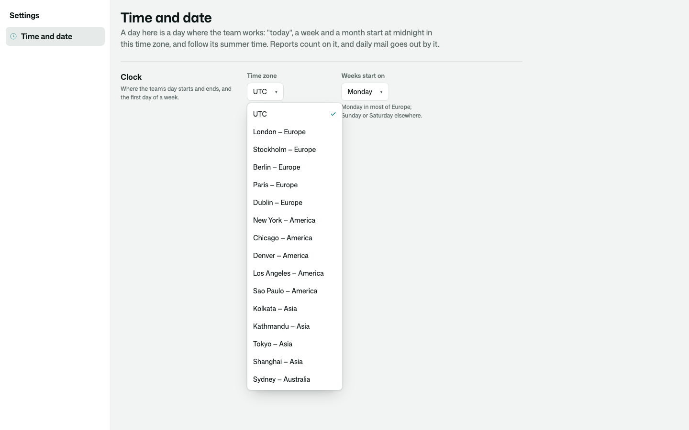
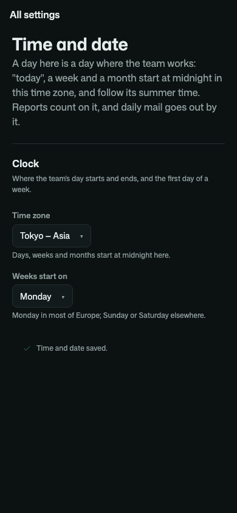

# Osysharp.TimeZone

One answer to "what day is it here?" for your whole app. Staff pick the time zone the team's days start in, and the day
a week starts, from a list on one settings page. Everything that counts in days reads it: reports start "today", "this
week" and "this month" at midnight there, and the daily digest goes out in the team's morning, in summer time as in
winter.



```osy
use Osysharp.TimeZone@0;

policy ManagesClock => IsLead;                                         // required unless your app defines IsAdmin (its default)
app.Clock = new ClockSetup { TimeZone = Zone.Of("Europe/Stockholm") };  // optional: the clock until staff pick one

var clock = TheClock();
var today = clock.DayOf(DateTime.UtcNow);          // the date on the team's wall
var since = clock.StartOf(clock.WeekOf(today));    // this week began here, at midnight
```

| | |
|---|---|
| **A typed time zone** | a `Zone`, picked from your app's declared zones, never typed. A name that is not a time zone cannot be saved |
| **One settings page** | Settings › Time and date: the zone and the first day of the week, saved with who changed it, drawn with no page code |
| **Every kit on one clock** | `Osysharp.Reports` counts its periods and buckets on it, `Osysharp.Notifications` sends its digest by it |
| **Days that follow summer time** | `DayOf`, `StartOf` and `WeekOf` are the date, the midnight and the week start on the team's wall |
| **Your zones** | the platform's set by default; declare `zones { … }` in your app to offer exactly the ones your teams work in |
| **Read by everybody** | the clock is not a secret, so a public page can say "open until 17:00" on it; only `ManagesClock` changes it |



`use Osysharp.TimeZone@0;` needs `Osysharp.Ui`.
